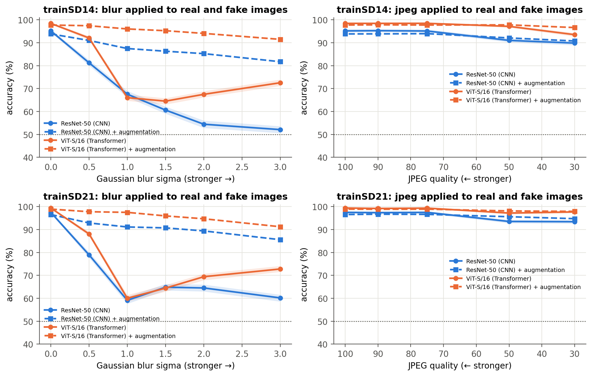
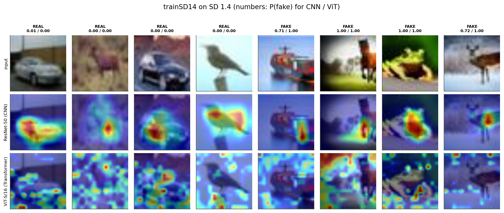

# Are Vision Transformers More Robust Detectors of AI-Generated Images than CNNs?

AI image generators now produce pictures that people can't reliably tell apart from real photographs, which makes them easy to use for misinformation, scams and deepfakes. Automatic detectors can help, but a detector is usually trained on one generator, and new generators keep appearing. A detector is only useful if it keeps working on fakes from a generator it has never seen, and on images that have been blurred or compressed.

This project compares the two main families of vision models on exactly that problem:

- **ResNet-50**, a convolutional neural network (CNN) that reads an image through small local filters
- **ViT-S/16**, a Vision Transformer that splits an image into patches and relates every patch to every other one

Both models have a similar number of parameters (23.5M and 21.7M), start from ImageNet-pretrained weights, and are fine-tuned in the same way to classify images as **real** or **AI-generated**. They are trained on fakes from one version of Stable Diffusion and then tested on:

- fakes from **newer generators** they never saw (Stable Diffusion 2.1 and 3.0)
- **blurred fakes**, an easy way for someone to try to hide a fake
- real and fake images that are both **blurred or JPEG-compressed**, as happens when images are re-shared online

The project extends Jiang (2024), whose robustness tests covered CNNs only, and uses Grad-CAM to show which parts of an image each model relies on.

## Key findings

- **On the generator it was trained on, the ViT is the better detector:** 97.9% vs 95.2% accuracy (SD 1.4) and 99.2% vs 97.5% (SD 2.1), with two to four times fewer real photos wrongly flagged as fake.
- **On unseen generators, the ViT's accuracy is no better than the CNN's**, but it still separates real from fake better (higher AUROC on all four unseen-generator tests). Its scores shift, so the default 0.5 cut-off lands in the wrong place.
- **Re-setting the cut-off with only 200 labelled images** makes the ViT the best detector on every unseen generator, for example 86.2% vs 82.1% on SD 3.0 after training on SD 2.1 (up from 71.3%).
- **Blurring a fake defeats the ViT:** it caught only 13% (trained on SD 1.4) and 25% (trained on SD 2.1) of blurred fakes, compared with about 80% for the CNN. This suggests the ViT learned a "sharp means fake" shortcut.
- **Blur and JPEG augmentation fixes the blur weakness** (the augmented ViT catches up to 96% overall on the blurred set) but lowers accuracy on the newest generator, SD 3.0, by 3 to 6 points.
- **Grad-CAM** shows the CNN focusing on the object in the centre of the image, while the ViT spreads its attention across the whole image.

Neither architecture is robust on its own: what a detector is trained on, and how its threshold is set, matter as much as its architecture.

## Datasets

| Dataset | Fake images generated by | Used for |
|---|---|---|
| [CIFAKE](https://www.kaggle.com/datasets/birdy654/cifake-real-and-ai-generated-synthetic-images) (Bird & Lotfi, 2024) | Stable Diffusion 1.4 | Training setup 1 and testing |
| [SD 2.1 CIFAKE 512-32JPG](https://www.kaggle.com/datasets/justinjiangnext/d21cifake-512pxjpg) (Jiang, 2024) | Stable Diffusion 2.1 | Training setup 2 and testing |
| [Stable Diffusion 3.0 CIFAKE, 32x32 JPG (1024)](https://www.kaggle.com/datasets/justinjiangnext/sd30cifake-32jpg) (Jiang, 2024) | Stable Diffusion 3.0 | Testing only (unseen generator) |
| [Gaussian Blurred SD2.1 Images](https://www.kaggle.com/datasets/justinjiangnext/gaussianblur) (Jiang, 2024) | Stable Diffusion 2.1, then blurred | Testing only |

All images are 32×32 JPEGs of the ten CIFAR-10 classes (airplane, car, bird, cat, deer, dog, frog, horse, ship, truck). The real images are CIFAR-10 photographs (Krizhevsky, 2009), shared by both training setups so that the only difference between them is the generator behind the fakes.

**Why these datasets:** they change one thing at a time (the generator), they match the setup of Jiang (2024) so the results can be compared directly, and real and fake images share the same size and file format, so a model can't tell them apart from file properties alone. The low resolution is also a limitation: fine generator artefacts are lost at 32×32, and real-world fakes are high-resolution.

## Method

| Step | Details |
|---|---|
| Splits | 10,000 real + 10,000 fake training images per setup, class-balanced; 10,000 + 10,000 per test set. SD 2.1 test images are held out before training images are chosen. |
| Leakage control | Images identical to a training image (SHA-1 pixel hash) are removed from validation and test sets. Blurred fakes are matched to their originals by image content, confirming none come from the training set. |
| Models | ResNet-50 (`resnet50.a1_in1k`) and ViT-S/16 (`vit_small_patch16_224.augreg_in21k_ft_in1k`) from timm, with a single real/fake output. Images are upsampled to 224×224. |
| Training | AdamW, warm-up + cosine learning-rate schedule, mixed precision, up to 6 epochs with early stopping. Each model is trained with three seeds (42, 1, 2), plus one version with blur and JPEG augmentation (Wang et al., 2020): 16 models in total. |
| Evaluation | Accuracy with 95% bootstrap confidence intervals, accuracy on fakes and reals, false accusation rate, AUROC, McNemar's test, blur and JPEG robustness curves, Grad-CAM, score distributions, threshold recalibration and per-class results. |

## Results

Every main model was trained with three seeds; values are mean ± standard deviation, with AUROC in brackets.

**Test accuracy (%)**

| Trained on | Model | SD 1.4 | SD 2.1 | SD 3.0 | Blurred SD 2.1 | False accusations |
|---|---|---|---|---|---|---|
| SD 1.4 | ResNet-50 | 95.2 ± 0.0 (99.0) | 93.4 ± 0.1 (98.3) | **90.1** ± 0.4 (97.2) | **87.8** ± 3.8 (96.4) | 5.1% |
| SD 1.4 | ViT-S/16 | **97.9** ± 0.8 (99.8) | **95.5** ± 0.3 (99.4) | 89.4 ± 1.8 (98.2) | 55.5 ± 5.3 (91.1) | **2.0%** |
| SD 2.1 | ResNet-50 | 81.0 ± 1.1 (94.8) | 97.5 ± 0.1 (99.7) | **75.3** ± 1.0 (90.2) | **88.6** ± 3.1 (98.1) | 2.5% |
| SD 2.1 | ViT-S/16 | **83.0** ± 1.7 (98.0) | **99.2** ± 0.1 (100.0) | 71.3 ± 1.5 (94.2) | 62.3 ± 8.8 (97.5) | **0.7%** |

**Accuracy (%) after re-setting the cut-off on 100 real + 100 fake labelled images**

| Trained on | Tested on | ResNet-50 (0.5 cut-off → recalibrated) | ViT-S/16 (0.5 cut-off → recalibrated) |
|---|---|---|---|
| SD 1.4 | SD 2.1 | 93.4 → 93.2 | 95.5 → **96.1** |
| SD 1.4 | SD 3.0 | 90.1 → 91.1 | 89.5 → **93.2** |
| SD 2.1 | SD 1.4 | 81.0 → 86.5 | 83.0 → **91.8** |
| SD 2.1 | SD 3.0 | 75.4 → 82.1 | 71.3 → **86.2** |
| SD 1.4 | Blurred SD 2.1 | 87.8 → **92.7** | 55.5 → 85.6 |
| SD 2.1 | Blurred SD 2.1 | 88.7 → **94.7** | 62.3 → 93.4 |

**Effect of blur and JPEG augmentation (accuracy %, seed 42 vs mean of main models)**

| Trained on | Model | Blurred SD 2.1 | SD 3.0 | In-domain |
|---|---|---|---|---|
| SD 1.4 | ResNet-50 | 87.8 → 77.1 | 90.1 → 85.8 | 95.2 → 93.6 |
| SD 1.4 | ViT-S/16 | 55.5 → **80.0** | 89.4 → 86.7 | 97.9 → 98.1 |
| SD 2.1 | ResNet-50 | 88.6 → 90.5 | 75.3 → 70.4 | 97.5 → 96.2 |
| SD 2.1 | ViT-S/16 | 62.3 → **95.8** | 71.3 → 65.2 | 99.2 → 99.0 |





All result tables are in [`outputs/results/`](outputs/results/) and all figures in [`outputs/figures/`](outputs/figures/). The trained models and processed data are available on [Google Drive](https://drive.google.com/drive/folders/1iClMK8QN5e4zw3phZ0wAXaqeeXERRmKo?usp=sharing).

## Notebooks

| Notebook | What it does |
|---|---|
| [`01_preprocessing.ipynb`](01_preprocessing.ipynb) | Downloads the four datasets, builds class-balanced splits, matches blurred fakes to their originals, removes leaked and duplicate images, and plots sample images and frequency spectra |
| [`02_training.ipynb`](02_training.ipynb) | Fine-tunes ResNet-50 and ViT-S/16 on both training setups with three seeds, plus blur/JPEG-augmented versions (16 runs) |
| [`03_evaluation.ipynb`](03_evaluation.ipynb) | Evaluates every model on every test set: main metrics, comparison with Jiang (2024), significance tests, robustness, Grad-CAM, score distributions, threshold recalibration and per-class results |
| [`04_demo.ipynb`](04_demo.ipynb) | Interactive Gradio demo (see below) |

## Demo

[`04_demo.ipynb`](04_demo.ipynb) launches an interactive Gradio app, *Forger vs Detective*, with four tabs:

1. **Can you tell?** The audience guesses which images are real or AI-generated, and their score is compared with both detectors.
2. **The forger gets better.** A live test of the detectors on fakes from newer generators they were not trained on.
3. **Blur attack.** A slider blurs an image and shows how each detector's confidence changes.
4. **Explain.** Upload any image to see both detectors' predictions and their Grad-CAM heat maps.

The app is a research prototype: images are reduced to 32×32 pixels, so predictions on real-world photographs are unreliable and should never be used to accuse anyone of faking an image.

## Repository structure

```
├── 01_preprocessing.ipynb
├── 02_training.ipynb
├── 03_evaluation.ipynb
├── 04_demo.ipynb
├── outputs/
│   ├── results/      result tables (CSV)
│   └── figures/      figures (PNG)
├── requirements.txt
└── README.md
```

The datasets and trained models are not included because of their size. The datasets can be downloaded from the Kaggle links above, and the trained models and processed data from [Google Drive](https://drive.google.com/drive/folders/1iClMK8QN5e4zw3phZ0wAXaqeeXERRmKo?usp=sharing).

## Limitations

- Images are 32×32, so fine generator artefacts are lost and results may not transfer to high-resolution fakes.
- The ViT was pretrained on more data (ImageNet-21k) than the ResNet (ImageNet-1k), so part of its advantage may come from pretraining.
- Only Stable Diffusion models are tested; GANs and face deepfakes are not.
- The real photos date from around 2009 while the fakes are recent, and there are no faces or people in the data.

## References

- Bird, J. J., & Lotfi, A. (2024). CIFAKE: Image classification and explainable identification of AI-generated synthetic images. *IEEE Access, 12*, 15642–15650. https://arxiv.org/abs/2303.14126
- Corvi, R., Cozzolino, D., Zingarini, G., Poggi, G., Nagano, K., & Verdoliva, L. (2023). On the detection of synthetic images generated by diffusion models. In *ICASSP 2023*. https://arxiv.org/abs/2211.00680
- Dosovitskiy, A., et al. (2021). An image is worth 16x16 words: Transformers for image recognition at scale. In *ICLR*. https://arxiv.org/abs/2010.11929
- Frank, J., Eisenhofer, T., Schönherr, L., Fischer, A., Kolossa, D., & Holz, T. (2020). Leveraging frequency analysis for deep fake image recognition. In *ICML*. https://arxiv.org/abs/2003.08685
- Geirhos, R., et al. (2020). Shortcut learning in deep neural networks. *Nature Machine Intelligence, 2*(11), 665–673. https://arxiv.org/abs/2004.07780
- Grommelt, P., Weiss, L., Pfreundt, F.-J., & Keuper, J. (2024). *Fake or JPEG? Revealing common biases in generated image detection datasets* [Preprint]. https://arxiv.org/abs/2403.17608
- Guo, C., Pleiss, G., Sun, Y., & Weinberger, K. Q. (2017). On calibration of modern neural networks. In *ICML*. https://arxiv.org/abs/1706.04599
- He, K., Zhang, X., Ren, S., & Sun, J. (2016). Deep residual learning for image recognition. In *CVPR*. https://arxiv.org/abs/1512.03385
- Jiang, J. (2024). *Addressing vulnerabilities in AI-image detection: Challenges and proposed solutions* [Preprint]. https://arxiv.org/abs/2412.00073
- Krizhevsky, A. (2009). *Learning multiple layers of features from tiny images* [Technical report]. University of Toronto. https://www.cs.toronto.edu/~kriz/cifar.html
- Naseer, M., et al. (2021). Intriguing properties of vision transformers. In *NeurIPS*. https://arxiv.org/abs/2105.10497
- Nightingale, S. J., & Farid, H. (2022). AI-synthesized faces are indistinguishable from real faces and more trustworthy. *PNAS, 119*(8), e2120481119. https://doi.org/10.1073/pnas.2120481119
- Ojha, U., Li, Y., & Lee, Y. J. (2023). Towards universal fake image detectors that generalize across generative models. In *CVPR*. https://arxiv.org/abs/2302.10174
- Paul, S., & Chen, P.-Y. (2022). Vision transformers are robust learners. In *AAAI*. https://arxiv.org/abs/2105.07581
- Selvaraju, R. R., et al. (2017). Grad-CAM: Visual explanations from deep networks via gradient-based localization. In *ICCV*. https://arxiv.org/abs/1610.02391
- Wang, S.-Y., Wang, O., Zhang, R., Owens, A., & Efros, A. A. (2020). CNN-generated images are surprisingly easy to spot... for now. In *CVPR*. https://arxiv.org/abs/1912.11035
- Wightman, R. (2019). *PyTorch image models*. https://github.com/huggingface/pytorch-image-models
